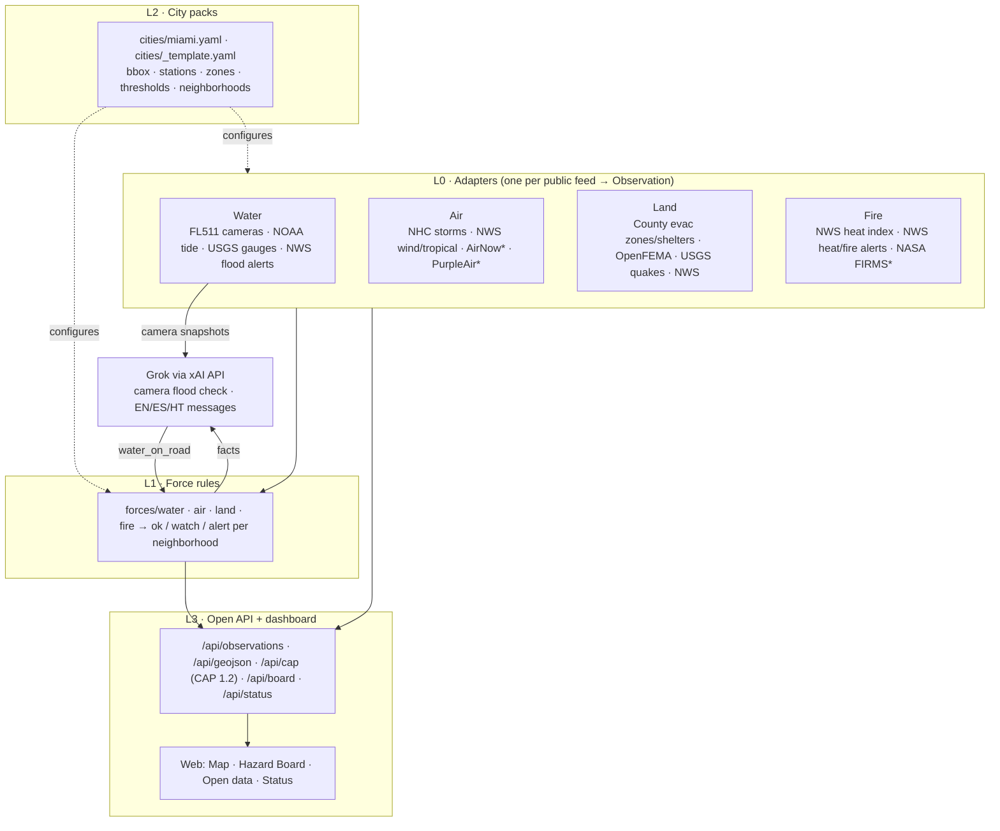
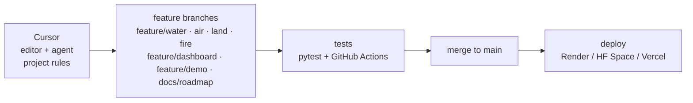

# FourForces Watch

**An open, reusable civic hazard map for water, air, land and fire, starting with Miami-Dade.**

> Built at **Hack for Humanity Miami** (The AI Collective × MLH Hacktoberfest Hack Day), The LAB Miami, Oct 10, 2026.
> Track: **Build for Miami: 04 Data to Action** (secondary: 01 Four Forces, water).
> Live demo: _<add URL>_ · Video: _<add URL>_ · Delivery tracking: [DELIVERY.md](DELIVERY.md) · Demo script: [docs/DEMO.md](docs/DEMO.md)

## What is in this project

FourForces Watch pulls public sensor feeds and official alerts into **one common data format** (an `Observation`).
It uses **Grok (xAI API)** to look at public traffic-camera snapshots for **water on the road**, and it summarizes
each neighborhood on a **Hazard Board** in **English, Spanish and Haitian Creole**.


<sub>* needs a free key; the adapter skips itself gracefully when the key is missing.</sub>

### Feeds per force

| Force | Feed | Key | What it gives |
|---|---|---|---|
| Water | [FL511 traffic cameras (FDOT ArcGIS)](https://services.arcgis.com/3wFbqsFPLeKqOlIK/arcgis/rest/services/FL511_Traffic_Cameras/FeatureServer) | no | 389 Miami-Dade cameras + snapshot links → Grok water-on-road check |
| Water | [NOAA CO-OPS](https://api.tidesandcurrents.noaa.gov/api/prod/) Virginia Key 8723214 | no | water level, anomaly vs forecast, projected next high, flood thresholds |
| Water | [USGS NWIS](https://waterservices.usgs.gov/) county 12086, gauge height | no | 60+ canal gauges, 3-hour rise |
| Water | [NWS alerts](https://www.weather.gov/documentation/services-web-api) | no | flood / coastal flood / storm surge |
| Air | [NHC CurrentStorms.json](https://www.nhc.noaa.gov/CurrentStorms.json) | no | active storms + distance to city |
| Air | NWS alerts | no | wind / tropical / tornado / air quality |
| Air | [EPA AirNow](https://docs.airnowapi.org/) | free key | official AQI |
| Air | [PurpleAir](https://api.purpleair.com/) | key | neighborhood PM2.5 → AQI (EPA 2024 breakpoints, uncorrected) |
| Land | Miami-Dade GIS: [evacuation zones](https://services.arcgis.com/8Pc9XBTAsYuxx9Ny/arcgis/rest/services/HurricaneEvacZone_gdb/FeatureServer/0), [order flags](https://services.arcgis.com/8Pc9XBTAsYuxx9Ny/arcgis/rest/services/EvacuationOrder/FeatureServer/0), [open shelters](https://services.arcgis.com/8Pc9XBTAsYuxx9Ny/arcgis/rest/services/EvacuationCenterShelters_Open/FeatureServer/0) | no | zone per neighborhood; order flags shown as "confirm with official channels" |
| Land | [OpenFEMA declarations](https://www.fema.gov/openfema-data-page/disaster-declarations-summaries-v2) | no | active disaster declarations for the county |
| Land | [USGS earthquakes](https://earthquake.usgs.gov/fdsnws/event/1/) | no | generic; for reuse in other cities |
| Land | NWS alerts | no | evacuation / civil emergency |
| Fire | NWS station KMIA + hourly forecast | no | heat index now + 12-hour forecast peak |
| Fire | NWS alerts | no | heat advisory / extreme heat / red flag |
| Fire | [NASA FIRMS](https://firms.modaps.eosdis.nasa.gov/api/) | free key | satellite active-fire detections |

### How to run

```bash
python3 -m venv .venv && source .venv/bin/activate
pip install -r requirements.txt
cp .env.example .env            # add XAI_API_KEY (https://console.x.ai); other keys optional
python -m scripts.check_feeds   # live / needs key / failing, per feed
uvicorn app:app --port 8000     # http://localhost:8000
DEMO_MODE=1 uvicorn app:app --port 8000   # dry-day demo (clearly labelled SIMULATED)
```
Tests: `pip install pytest && pytest -q` · classify one photo: `python -m scripts.classify_image photo.jpg` ·
hosting: [DEPLOY.md](DEPLOY.md) (Docker, Hugging Face Spaces, Render).

### Reuse it in another city

1. Copy `cities/_template.yaml` to `cities/<city>.yaml`. Fill in:
   - bbox;
   - NOAA tide station + flood thresholds;
   - USGS county code;
   - NWS point + zones;
   - neighborhoods with centroids.
2. Run with `CITY=<city>`.
3. Outside Florida, add `adapters/water/<your_511>_cameras.py` for your state's camera feed (most 511 systems publish
   locations + snapshot URLs). Rules, AI check, API and dashboard work unchanged.

---

## The problem

Miami floods on sunny days: king tides push seawater up through storm drains, and summer storms dump inches of rain
in an hour. The data that matters is public but split across NOAA, USGS, NWS, NHC, FEMA, EPA, county GIS and FDOT's
cameras. Nobody watches the cameras to see whether streets are actually underwater.

## Who it helps

- **Residents and commuters**: is my area flooding or dangerous right now? Answered in English, Spanish or Kreyòl.
- **Neighborhood groups, journalists, civic technologists**: one open feed (JSON, GeoJSON, CAP 1.2) instead of eight APIs.
- **Other cities**: one YAML city pack.

## The web app

- **Map:**
  - **Camera colors:** grey = not checked, green = dry, amber = possible water, red = water on road.
  - **Camera popup:** live snapshot, Grok verdict, tide and active NWS flood alerts, plus a "Check now with Grok" button.
  - **Layer toggles:** one per force.
- **Hazard Board:** 10 neighborhoods × 4 force badges, the reasons, and an EN/ES/HT message.
- **Open data:** links to every endpoint.
- **Status:** live health of each feed (state, item count, last fetch, last success, latency, error), plus AI key/model status.

## AI: Grok via the xAI API

| Use | Model (env var, default) | How |
|---|---|---|
| Flood check on camera images | `XAI_VISION_MODEL`, default `grok-4.7` | [xAI Responses API](https://docs.x.ai/docs/guides/image-understanding) with a base64 image + strict-JSON prompt → `{water_on_road, confidence, note}`; `store: false` |
| Trilingual neighborhood messages | `XAI_TEXT_MODEL`, default `grok-4.20-0309-non-reasoning` | Text prompt built only from the rule engine's facts; told never to issue orders |

- **Cost control:**
  - vision verdicts are cached per image SHA-256, so an unchanged frame is never re-sent;
  - each refresh checks at most `MAX_CLASSIFY` cameras (default 12), rotating through all of them;
  - messages are cached until conditions change.
- **Without `XAI_API_KEY`:** cameras stay "not checked" and the board uses fixed EN/ES/HT templates. All data feeds keep working.
- **Model availability:** model ids follow [docs.x.ai/docs/models](https://docs.x.ai/docs/models). Change them via env if needed.
- **Honest note:** the Grok API models are **hosted, proprietary models, not open-weight**. The project code is open
  source (MIT); the AI layer is one module (`detect/grok.py`) behind a small interface, so it can be swapped for
  another provider or a self-hosted open model.
- **Terms:** use of the xAI API is subject to xAI's terms of service.

## Open API

| Endpoint | Returns |
|---|---|
| `GET /api/observations?force=water\|air\|land\|fire&status=watch,alert&source=` | Observations |
| `GET /api/cameras?status=` · `POST /api/cameras/{id}/check` | cameras + AI verdicts · check one camera now |
| `GET /api/tide` | observed, predicted, anomaly, projected next high |
| `GET /api/board` (alias `/api/hazards`) | Hazard Board tiles + EN/ES/HT messages |
| `GET /api/geojson?force=` | GeoJSON FeatureCollection |
| `GET /api/cap?force=` | watch/alert items as OASIS CAP 1.2 `<alert>` elements |
| `GET /api/status` | feed health (last fetch / last success / count / error), AI status, demo flag |
| `GET /healthz` · `/docs` | liveness · OpenAPI docs |

One schema for everything:
```json
{"force": "water", "source": "noaa_tide",
 "place": {"id": "noaa-8723214", "name": "Virginia Key tide gauge (NOAA 8723214)", "lat": 25.7314, "lon": -80.1618},
 "time": "2026-10-10T15:00:00Z", "measurement": "water_level", "value": 3.12, "unit": "ft MLLW",
 "threshold": 3.53, "status": "watch", "extra": {"anomaly_ft": 0.77, "scope": "area"}}
```
An agent skill in the [agentskills.io](https://agentskills.io) format, `skills/fourforces-watch/`, lets AI agents query this API.

## Extend it

- **New source:** add a module to `adapters/<force>/` with `NAME`, `FORCE` and `fetch(city) -> list[Observation]`.
  Raise `SkipAdapter` when a key is missing. It is auto-discovered.
- **Adapters kept in another repository:** make them importable and list them in `ADAPTER_PACKAGES=pkg.a,pkg.b`.
- **Consume instead of fork:** `/api/geojson` and `/api/cap` plug into GIS and alerting tools.
- **New rules / thresholds:** `forces/<force>.py` and the city pack.

## Data terms and the dry-day demo

- **FL511 camera images** © FDOT/FL511. They are **not stored or redistributed:** the browser hot-links them, and the
  server reads them in memory only for the AI check. Only the verdict and the image hash are cached.
- **Other feeds:** the NOAA, USGS, NWS and NHC feeds are US Government works (public domain). OpenFEMA, AirNow,
  PurpleAir, NASA FIRMS and Miami-Dade GIS apply their own terms (links above).
- **Demo images:** 5 photos of real Miami tidal flooding (2016) by Wikimedia Commons user **B137**, **CC0 1.0** (see
  `demo/sources.yaml`). They are fetched at runtime, never committed, used only with `DEMO_MODE=1`, and always
  labelled **SIMULATED** (banner, popup tag, `extra.simulated`).
- **Map:** [Leaflet](https://leafletjs.com) (BSD-2); tiles © OpenStreetMap contributors © CARTO.

## Limitations

- Highway cameras are low-resolution and often dark: "water on road" is a **lead to verify**, not ground truth.
- Cameras sit mostly on highways, while sunny-day flooding hits low local streets first. That's why cameras are combined with the tide gauge and NWS alerts.
- **Not an official warning system.** Follow the National Weather Service and Miami-Dade Emergency Management.

## Project layout
```
core/      schema.py (Observation, GeoJSON, CAP 1.2) · city.py · http.py
cities/    miami.yaml · _template.yaml                         (L2)
adapters/  water/ air/ land/ fire/ · nws.py · base.py          (L0)
forces/    water.py air.py land.py fire.py · engine.py         (L1)
detect/    grok.py (xAI vision + text) · messages.py (EN/ES/HT)
web/       index.html · app.js · style.css                     (L3 dashboard)
app.py     FastAPI: open API + 5-minute background refresh     (L3 API)
demo/      dry-day demo (CC0 images fetched at runtime)
docs/      DEMO.md  ·  skills/ (agent skill)  ·  DELIVERY.md  ·  DEPLOY.md  ·  ROADMAP.md
.cursor/rules/fourforces.mdc · AGENTS.md · .github/workflows/tests.yml   (dev pipeline)
```

## Development pipeline



1. **Cursor** (editor and agent) loads the project rules in [`.cursor/rules/fourforces.mdc`](.cursor/rules/fourforces.mdc). [`AGENTS.md`](AGENTS.md) gives the same guidance to any AI coding agent:
   - adapter interface and common Observation schema;
   - one adapter per source per force;
   - no secrets in the repo;
   - tests required;
   - no proprietary content.
2. Work happens on **feature branches**: `feature/water`, `feature/air`, `feature/land`, `feature/fire`, `feature/dashboard`, `feature/demo`, `docs/roadmap`.
3. **Tests:** `pytest -q` runs locally and in CI ([`.github/workflows/tests.yml`](.github/workflows/tests.yml)) on every push and pull request.
4. **Merge to `main`**, which is always the integrated, working app. History is never rewritten.
5. **Deploy** from `main` (see [DEPLOY.md](DEPLOY.md)). Progress is tracked in [DELIVERY.md](DELIVERY.md), and milestones in [ROADMAP.md](ROADMAP.md).


## Team

- **Sébastien Vaval**
- **Enrique Escobar**

## AI tools used

| Tool | Where | Role |
|---|---|---|
| **Grok via the xAI API** (`grok-4.7` vision, `grok-4.20-0309-non-reasoning` text) | runtime | flood check on camera images; EN/ES/HT hazard messages |
| **Grok Build / Grok Bot** (AI coding assistant) | development | wrote and iterated on the code, tests and docs under the team's direction |
| **Cursor** (AI code editor + agent) | development | editing and agent work, guided by `.cursor/rules/fourforces.mdc` and `AGENTS.md` |

Grok API models are not open-weight (see "AI" above).

## Build-time disclosure

All code was written **during the official hackathon build window (from 11:00 AM ET, Oct 10, 2026)** with AI coding
assistance. Before build time, the team only researched and checked the public endpoints listed here.

## License

[MIT](LICENSE) © 2026 FourForces Watch contributors. Third-party data, images and AI services keep their own terms.
