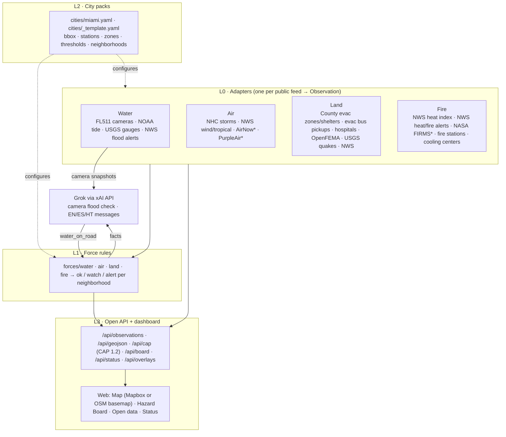
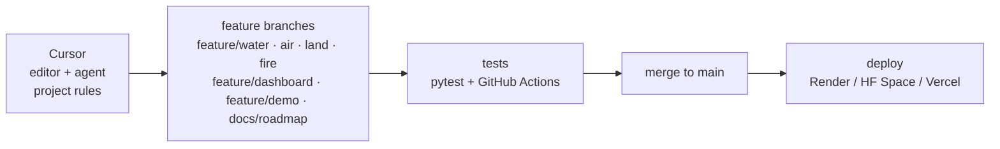

# FourForces Watch

**An open, reusable civic hazard map for water, air, land and fire, starting with Miami-Dade.**

> Built at **Hack for Humanity Miami** (The AI Collective × MLH Hacktoberfest Hack Day), The LAB Miami, Oct 10, 2026.
> Track: **Build for Miami: 04 Data to Action** (secondary: 01 Four Forces, water).
> Repo: https://github.com/SebastienVaval/fourforces-watch · Live demo: _deploy pending (see [DEPLOY.md](DEPLOY.md))_ · Video: _link added at submission_ ·
> Roadmap: [ROADMAP.md](ROADMAP.md) · Delivery tracking: [DELIVERY.md](DELIVERY.md) · Demo script: [docs/DEMO.md](docs/DEMO.md)

## What is in this project

FourForces Watch pulls public sensor feeds and official alerts into **one common data format** (an `Observation`).
It uses **Grok (xAI API)** to look at public traffic-camera snapshots for **water on the road**, and it summarizes
each neighborhood on a **Hazard Board** in **English, Spanish and Haitian Creole**.


<sub>* needs a free key; the adapter skips itself gracefully when the key is missing.</sub>

### Feeds per force

| Force | Feed | Key | What it gives |
|---|---|---|---|
| Water | [FL511 traffic cameras (FDOT ArcGIS)](https://services.arcgis.com/3wFbqsFPLeKqOlIK/arcgis/rest/services/FL511_Traffic_Cameras/FeatureServer) | no | 389 Miami-Dade cameras + snapshot links → Grok water-on-road check |
| Water | [NOAA CO-OPS](https://api.tidesandcurrents.noaa.gov/api/prod/) Virginia Key 8723214 | no | water level, anomaly vs forecast, projected next high, flood thresholds |
| Water | [USGS NWIS](https://waterservices.usgs.gov/) county 12086, gauge height | no | 60+ canal gauges, 3-hour rise |
| Water | [NWS alerts](https://www.weather.gov/documentation/services-web-api) | no | flood / coastal flood / storm surge |
| Air | [NHC CurrentStorms.json](https://www.nhc.noaa.gov/CurrentStorms.json) | no | active storms + distance to city |
| Air | NWS alerts | no | wind / tropical / tornado / air quality |
| Air | [EPA AirNow](https://docs.airnowapi.org/) `/aq/data/` (bbox, last 3 h, `dataType=A`) | free key | official hourly AQI per monitor and pollutant (PM2.5, ozone, PM10) |
| Air | [PurpleAir](https://api.purpleair.com/) v1 `/sensors` (outdoor, bbox) | key | neighborhood PM2.5 → AQI (US EPA correction, EPA 2024 breakpoints) |
| Land | Miami-Dade GIS: [evacuation zones](https://services.arcgis.com/8Pc9XBTAsYuxx9Ny/arcgis/rest/services/HurricaneEvacZone_gdb/FeatureServer/0), [order flags](https://services.arcgis.com/8Pc9XBTAsYuxx9Ny/arcgis/rest/services/EvacuationOrder/FeatureServer/0), [open shelters](https://services.arcgis.com/8Pc9XBTAsYuxx9Ny/arcgis/rest/services/EvacuationCenterShelters_Open/FeatureServer/0) | no | zone per neighborhood; order flags shown as "confirm with official channels" |
| Land | [OpenFEMA declarations](https://www.fema.gov/openfema-data-page/disaster-declarations-summaries-v2) | no | active disaster declarations for the county |
| Land | [USGS earthquakes](https://earthquake.usgs.gov/fdsnws/event/1/) | no | generic; for reuse in other cities |
| Land | NWS alerts | no | evacuation / civil emergency |
| Fire | NWS station KMIA + hourly forecast | no | heat index now + 12-hour forecast peak |
| Fire | NWS alerts | no | heat advisory / extreme heat / red flag |
| Fire | [NASA FIRMS](https://firms.modaps.eosdis.nasa.gov/api/) VIIRS NOAA-20/21 + SNPP + MODIS | free key | satellite active-fire detections, last 48 h, Everglades edge included |
| Land | [Miami-Dade County Open Data](https://gis-mdc.opendata.arcgis.com/): [hurricane evacuation bus pickups](https://services.arcgis.com/8Pc9XBTAsYuxx9Ny/arcgis/rest/services/Hurricane_Bus_Stops/FeatureServer/0) (129), [hospitals](https://services.arcgis.com/8Pc9XBTAsYuxx9Ny/arcgis/rest/services/Miami_Dade_Hospitals/FeatureServer/0) (37) | no | reference sites on the map (`county_gis_land`); never change a status |
| Fire | Miami-Dade County Open Data: [fire stations](https://services.arcgis.com/8Pc9XBTAsYuxx9Ny/arcgis/rest/services/FireStation_gdb/FeatureServer/0) (75), [cooling centers](https://services.arcgis.com/8Pc9XBTAsYuxx9Ny/arcgis/rest/services/Cooling_Centers/FeatureServer/0) (65) | no | reference sites on the map (`county_gis_fire`); never change a status |

### Map overlays (Miami-Dade County Open Data)

Polygon and line layers from the county's [ArcGIS Hub portal](https://gis-mdc.opendata.arcgis.com/), served as
GeoJSON at `/api/overlays/<id>` (cached 6 h, simplified) and toggled in the map's layer control. URLs live in
`cities/miami.yaml` under `open_data`; the code (`core/arcgis.py`) works for any ArcGIS Hub city. Feature counts were
checked live on Oct 10, 2026.

| Force | Overlay (`id`) | Features |
|---|---|---|
| Land | [Storm surge planning / evacuation zones A–E](https://services.arcgis.com/8Pc9XBTAsYuxx9Ny/arcgis/rest/services/StormSurgePlanningZone_Multipart/FeatureServer/0) (`mdc_surge_zones`, on by default) | 5 |
| Land | [Primary evacuation routes](https://services.arcgis.com/8Pc9XBTAsYuxx9Ny/arcgis/rest/services/PrimaryEvacuationRoute_gdb/FeatureServer/0) (`mdc_evac_routes`) | 152 |
| Water | [FEMA flood zone VE, coastal high hazard](https://services.arcgis.com/8Pc9XBTAsYuxx9Ny/arcgis/rest/services/FEMAFloodZone_VEView/FeatureServer/0) (`mdc_fema_ve`) | 192 |
| Water | [FEMA flood zone AE, 1% annual chance](https://services.arcgis.com/8Pc9XBTAsYuxx9Ny/arcgis/rest/services/FEMAFloodZone_AEView/FeatureServer/0) (`mdc_fema_ae`, ~2 MB) | 1,280 |
| Water | [Canals](https://services.arcgis.com/8Pc9XBTAsYuxx9Ny/arcgis/rest/services/Canal_gdb/FeatureServer/0) (`mdc_canals`) | 1,357 |
| Fire | [Urban heat island effect by census tract](https://services.arcgis.com/8Pc9XBTAsYuxx9Ny/arcgis/rest/services/Urban_Heat_Islands/FeatureServer/0) (`mdc_heat_islands`) | 248 |

The county's pre-designated shelter list and the open-shelters layer are empty outside an activation; the open
shelters layer is already polled by `evac_zones` and appears automatically when the county opens shelters.

### Water force

- **Sources:** FL511 cameras (Grok water-on-road check), NOAA CO-OPS tide at Virginia Key 8723214 (level, anomaly vs
  prediction, rising/falling trend, next high tide projected with today's excess), USGS NWIS canal gauges (3-hour rise),
  NWS flood / coastal flood / storm surge alerts, and the FEMA flood zone (FIRM) at each neighborhood from Miami-Dade
  County Open Data (`water.flood_zones`).
- **Neighborhood rule:** camera water on road (≥ 60% confidence = alert, else watch); tide ≥ `watch_ft` = watch and ≥
  `minor_flood_ft` = alert, or a projected next high above minor flood = watch, **coastal zones only**; USGS gauge
  rising ≥ `rapid_rise_ft_3h` within `nearby_km` = watch (per-site `site_thresholds` optional); NWS flood alerts by zone.
  The FEMA zone is context only.
- **Hazard Board water tile:** FEMA zone with plain meaning, tide now + trend + next high (coastal tiles), nearest
  camera verdict (prefers a wet one, then a checked one, within `camera_radius_km`), nearest canal gauge. The
  "avoid flooded roads" tip appears only when water is watch/alert.
- **Water view** (🌊): only water layers, cameras by verdict, tide and gauges, FEMA VE + canals overlays, legend.
- Without `XAI_API_KEY` cameras stay "not checked" and the rest of the water force runs.

### Air force

- **AQI sources:** EPA AirNow (official regulatory monitors via `/aq/data/`, latest hour per monitor and pollutant; the old
  `observation/latLong/current` and `zipCode/current` services were retired on Oct 1, 2026) and PurpleAir outdoor sensors (neighborhood
  scale). PurpleAir PM2.5 uses the US EPA correction `0.524 × PM2.5_cf1 − 0.0862 × RH + 5.75` when the sensor reports
  humidity, else its uncorrected 10-minute average; sensors whose A/B channels disagree (`confidence` < 50) are dropped.
  AQI uses the EPA 2024 PM2.5 breakpoints (Good ≤ 9.0 µg/m³).
- **Neighborhood rule** (`air` in the city pack): the tile AQI is the median of sensors within `sensor_radius_km` (5);
  each monitor counts with its worst pollutant; with no monitor or sensor near, the worst current AirNow reading in
  the city applies. AQI ≥ `aqi_watch` (101, Unhealthy for Sensitive
  Groups) is watch, ≥ `aqi_alert` (151, Unhealthy) is alert. NHC storms (watch within 800 km, alert within 300 km) and
  NWS wind / tropical / air-quality alerts keep their own status.
- **Hazard Board air tile:** AQI value, EPA category and source (e.g. "median of 3 PurpleAir sensors within 5 km"), and
  the nearest NHC storm with its distance. Messages add an air-quality tip (limit outdoor activity, close windows,
  mask for sensitive groups) only when AQI is the cause, and a storm tip when a storm is.
- **Air view** (map side panel, 💨): only air layers, sensors in EPA category colors, NHC storm centers, legend, and the
  state of each AQI feed.
- **Keys** (both optional; the app runs without them and the adapters go live on the next refresh after you add them):
  - `AIRNOW_API_KEY`: free, request at <https://docs.airnowapi.org/account/request/>.
  - `PURPLEAIR_API_KEY`: a PurpleAir **read** key from <https://develop.purpleair.com/> (sign in, create a project, then
    a read key; usage uses PurpleAir points).
  The Status tab shows "needs AIRNOW_API_KEY" / "needs PURPLEAIR_API_KEY" until they are set.
- **Dry-day demo:** with `DEMO_MODE=1` **and** both AQI feeds off, `air.demo_sensors` adds three **SIMULATED** sensors
  (one Unhealthy for Sensitive Groups near Doral). Own source `demo_air`, `extra.simulated = true`, SIMULATED names and
  headlines, dashed yellow rings, banner text. They disappear as soon as a real AQI feed is live.

### Land force

- **Sources (no API key):** Miami-Dade hurricane evacuation zone and order flag at each neighborhood point, open shelters
  and evacuation bus pickups (county ArcGIS layers), OpenFEMA disaster declarations for the county, USGS earthquakes
  (FDSN bbox query, reusable in any city) and NWS evacuation / civil emergency alerts.
- **Neighborhood rule** (`land` in the city pack): a county order flag is **watch** ("confirm with official channels")
  unless `trust_orders: true`; an open FEMA declaration (or one ended < 14 days ago) is **watch** county-wide; an
  earthquake of `alert_magnitude` (4.5) or more within `alert_km` (50) is **alert**, any within `watch_km` (150) **watch**.
- **Hazard Board land tile:** evacuation zone, nearest open shelter, nearest evacuation bus pickup, open FEMA
  declarations (information only; shelters, pickups and hospitals never change a status).
- **Calm-day demo:** with `DEMO_MODE=1`, `land.demo_evac_orders` adds one **SIMULATED** evacuation order flag (Miami
  Beach, zone A). Own source `demo_land`, `extra.simulated = true`, SIMULATED headline, named in the page banner.

### Fire force

- **Satellite hotspots:** NASA FIRMS (VIIRS NOAA-20, NOAA-21, S-NPP and MODIS, last 48 h) in `fire.firms.bbox`, which
  reaches west to the Everglades. Confidence is normalised to low / nominal / high; popups show FRP (MW), sensor, pass
  time and the nearest county fire station (straight-line km).
- **Neighborhood rule** (`fire.hotspots` in the city pack): a detection of `min_confidence` (default nominal) or higher
  within `alert_km` (5) of a tile is **alert**, within `watch_km` (15) **watch**; low-confidence or farther detections
  are shown but do not count.
- **Heat:** NWS heat index now and 12-hour forecast peak (watch ≥ 103 F, alert ≥ 108 F) plus NWS heat / red flag / fire
  weather alerts.
- **Hazard Board fire tile:** nearest fire station, the two nearest cooling centers and, when within `watch_km`, the
  nearest hotspot (`fire.context`; county reference layers, information only). Messages add a fire/heat tip in EN/ES/HT
  (templates; Grok writes them when `XAI_API_KEY` is set).
- **Fire view** (map side panel, 🔥): shows only fire layers (hotspots, fire stations, cooling centers, urban heat island
  overlay) with a legend and a live summary.
- **Dry-day demo:** with `DEMO_MODE=1`, `fire.demo_hotspots` adds one **SIMULATED** hotspot (Everglades edge west of
  Doral). It has its own source (`demo_fire`, never mixed into `nasa_firms`), `extra.simulated = true`, a SIMULATED
  headline, a dashed yellow ring and popup tag, and is named in the page banner.

### Basemap: Mapbox (optional)

Set `MAPBOX_TOKEN` to a **public** Mapbox token (`pk.…`) and the dashboard uses Mapbox tiles (`MAPBOX_STYLE`,
default `mapbox/dark-v11`, plus streets and satellite in the layer control). The server hands the token to the
browser through `/api/config`; secret `sk.` tokens are refused. Without a token the map falls back to free
OpenStreetMap / CARTO tiles, so the public repo runs with no account. Restrict the token to your deploy URL in the
Mapbox dashboard.

### How to run

```bash
python3 -m venv .venv && source .venv/bin/activate
pip install -r requirements.txt
cp .env.example .env            # add XAI_API_KEY (https://console.x.ai); other keys optional
python -m scripts.check_feeds   # live / needs key / failing, per feed
uvicorn app:app --port 8000     # http://localhost:8000
DEMO_MODE=1 uvicorn app:app --port 8000   # dry-day demo (clearly labelled SIMULATED)
```
Tests: `pip install pytest && pytest -q` · classify one photo: `python -m scripts.classify_image photo.jpg` ·
hosting: [DEPLOY.md](DEPLOY.md) (Docker, Hugging Face Spaces, Render).

### Reuse it in another city

1. Copy `cities/_template.yaml` to `cities/<city>.yaml`. Fill in:
   - bbox;
   - NOAA tide station + flood thresholds;
   - USGS county code;
   - NWS point + zones;
   - neighborhoods with centroids.
2. Run with `CITY=<city>`.
3. Outside Florida, add `adapters/water/<your_511>_cameras.py` for your state's camera feed (most 511 systems publish
   locations + snapshot URLs). Rules, AI check, API and dashboard work unchanged.

---

## The problem

Miami floods on sunny days: king tides push seawater up through storm drains, and summer storms dump inches of rain
in an hour. The data that matters is public but split across NOAA, USGS, NWS, NHC, FEMA, EPA, county GIS and FDOT's
cameras. Nobody watches the cameras to see whether streets are actually underwater.

## Who it helps

- **Residents and commuters**: is my area flooding or dangerous right now? Answered in English, Spanish or Kreyòl.
- **Neighborhood groups, journalists, civic technologists**: one open feed (JSON, GeoJSON, CAP 1.2) instead of eight APIs.
- **Other cities**: one YAML city pack.

## The web app

- **Map:**
  - **Camera colors:** grey = not checked, green = dry, amber = possible water, red = water on road.
  - **Camera popup:** live snapshot, Grok verdict, tide and active NWS flood alerts, plus a "Check now with Grok" button.
  - **Layer toggles:** one per force, plus a layer control (top left) for the basemap and county open-data overlays.
  - **Reference sites:** small dots for fire stations, cooling centers, hospitals and evacuation bus pickups (info only).
- **Hazard Board:** 10 neighborhoods × 4 force badges, the reasons, and an EN/ES/HT message.
- **Open data:** links to every endpoint.
- **Status:** live health of each feed (state, item count, last fetch, last success, latency, error), plus AI key/model status.

## AI: Grok via the xAI API

| Use | Model (env var, default) | How |
|---|---|---|
| Flood check on camera images | `XAI_VISION_MODEL`, default `grok-4.7` | [xAI Responses API](https://docs.x.ai/docs/guides/image-understanding) with a base64 image + strict-JSON prompt → `{water_on_road, confidence, note}`; `store: false` |
| Trilingual neighborhood messages | `XAI_TEXT_MODEL`, default `grok-4.20-0309-non-reasoning` | Text prompt built only from the rule engine's facts; told never to issue orders |

- **Cost control:**
  - vision verdicts are cached per image SHA-256, so an unchanged frame is never re-sent;
  - each refresh checks at most `MAX_CLASSIFY` cameras (default 12), rotating through all of them;
  - messages are cached until conditions change.
- **Without `XAI_API_KEY`:** cameras stay "not checked" and the board uses fixed EN/ES/HT templates. All data feeds keep working.
- **Model availability:** model ids follow [docs.x.ai/docs/models](https://docs.x.ai/docs/models). Change them via env if needed.
- **Honest note:** the Grok API models are **hosted, proprietary models, not open-weight**. The project code is open
  source (MIT); the AI layer is one module (`detect/grok.py`) behind a small interface, so it can be swapped for
  another provider or a self-hosted open model.
- **Terms:** use of the xAI API is subject to xAI's terms of service.

## Open API

| Endpoint | Returns |
|---|---|
| `GET /api/observations?force=water\|air\|land\|fire&status=watch,alert&source=` | Observations |
| `GET /api/cameras?status=` · `POST /api/cameras/{id}/check` | cameras + AI verdicts · check one camera now |
| `GET /api/tide` | observed, predicted, anomaly, projected next high |
| `GET /api/board` (alias `/api/hazards`) | Hazard Board tiles + EN/ES/HT messages |
| `GET /api/geojson?force=` | GeoJSON FeatureCollection |
| `GET /api/cap?force=` | watch/alert items as OASIS CAP 1.2 `<alert>` elements |
| `GET /api/status` | feed health (last fetch / last success / count / error), AI status, demo flag |
| `GET /api/overlays` · `GET /api/overlays/{id}` | county open-data overlay list · one overlay as GeoJSON |
| `GET /api/config` | front-end config: public Mapbox token (if set), style, open-data attribution |
| `GET /healthz` · `/docs` | liveness · OpenAPI docs |

One schema for everything:
```json
{"force": "water", "source": "noaa_tide",
 "place": {"id": "noaa-8723214", "name": "Virginia Key tide gauge (NOAA 8723214)", "lat": 25.7314, "lon": -80.1618},
 "time": "2026-10-10T15:00:00Z", "measurement": "water_level", "value": 3.12, "unit": "ft MLLW",
 "threshold": 3.53, "status": "watch", "extra": {"anomaly_ft": 0.77, "scope": "area"}}
```
An agent skill in the [agentskills.io](https://agentskills.io) format, `skills/fourforces-watch/`, lets AI agents query this API.

## Extend it

- **New source:** add a module to `adapters/<force>/` with `NAME`, `FORCE` and `fetch(city) -> list[Observation]`.
  Raise `SkipAdapter` when a key is missing. It is auto-discovered.
- **Adapters kept in another repository:** make them importable and list them in `ADAPTER_PACKAGES=pkg.a,pkg.b`.
- **Consume instead of fork:** `/api/geojson` and `/api/cap` plug into GIS and alerting tools.
- **New rules / thresholds:** `forces/<force>.py` and the city pack.

## Data terms and the dry-day demo

- **FL511 camera images** © FDOT/FL511. They are **not stored or redistributed:** the browser hot-links them, and the
  server reads them in memory only for the AI check. Only the verdict and the image hash are cached.
- **Other feeds:** the NOAA, USGS, NWS and NHC feeds are US Government works (public domain). OpenFEMA, AirNow,
  PurpleAir, NASA FIRMS and Miami-Dade County Open Data apply their own terms (links above); county layers are
  credited as "Miami-Dade County Open Data" on the map and in popups.
- **Demo images:** 5 photos of real Miami tidal flooding (2016) by Wikimedia Commons user **B137**, **CC0 1.0** (see
  `demo/sources.yaml`). They are fetched at runtime, never committed, used only with `DEMO_MODE=1`, and always
  labelled **SIMULATED** (banner, popup tag, `extra.simulated`).
- **Map:** [Leaflet](https://leafletjs.com) (BSD-2); tiles © Mapbox © OpenStreetMap contributors when `MAPBOX_TOKEN`
  is set, otherwise © OpenStreetMap contributors © CARTO.

## Limitations

- Highway cameras are low-resolution and often dark: "water on road" is a **lead to verify**, not ground truth.
- Cameras sit mostly on highways, while sunny-day flooding hits low local streets first. That's why cameras are combined with the tide gauge and NWS alerts.
- **Not an official warning system.** Follow the National Weather Service and Miami-Dade Emergency Management.

## Project layout
```
core/      schema.py (Observation, GeoJSON, CAP 1.2) · city.py · http.py
cities/    miami.yaml · _template.yaml                         (L2)
adapters/  water/ air/ land/ fire/ · nws.py · base.py          (L0)
forces/    water.py air.py land.py fire.py · engine.py         (L1)
detect/    grok.py (xAI vision + text) · messages.py (EN/ES/HT)
web/       index.html · app.js · style.css                     (L3 dashboard)
app.py     FastAPI: open API + 5-minute background refresh     (L3 API)
demo/      dry-day demo (CC0 images fetched at runtime)
docs/      DEMO.md  ·  skills/ (agent skill)  ·  DELIVERY.md  ·  DEPLOY.md  ·  ROADMAP.md
.cursor/rules/fourforces.mdc · AGENTS.md · .github/workflows/tests.yml   (dev pipeline)
```

## Development pipeline



1. **Cursor** (editor and agent) loads the project rules in [`.cursor/rules/fourforces.mdc`](.cursor/rules/fourforces.mdc). [`AGENTS.md`](AGENTS.md) gives the same guidance to any AI coding agent:
   - adapter interface and common Observation schema;
   - one adapter per source per force;
   - no secrets in the repo;
   - tests required;
   - no proprietary content.
2. Work happens on **feature branches**: `feature/water`, `feature/air`, `feature/land`, `feature/fire`, `feature/dashboard`, `feature/demo`, `docs/roadmap`.
3. **Tests:** `pytest -q` runs locally and in CI ([`.github/workflows/tests.yml`](.github/workflows/tests.yml)) on every push and pull request.
4. **Merge to `main`**, which is always the integrated, working app. History is never rewritten.
5. **Deploy** from `main` (see [DEPLOY.md](DEPLOY.md)). Progress is tracked in [DELIVERY.md](DELIVERY.md), and milestones in [ROADMAP.md](ROADMAP.md).


## Team

- **Sébastien Vaval**
- **Enrique Escobar**

## AI tools used

| Tool | Where | Role |
|---|---|---|
| **Grok via the xAI API** (`grok-4.7` vision, `grok-4.20-0309-non-reasoning` text) | runtime | flood check on camera images; EN/ES/HT hazard messages |
| **Grok Build / Grok Bot** (AI coding assistant) | development | wrote and iterated on the code, tests and docs under the team's direction |
| **Cursor** (AI code editor + agent) | development | editing and agent work, guided by `.cursor/rules/fourforces.mdc` and `AGENTS.md` |

Grok API models are not open-weight (see "AI" above).

## Build-time disclosure

All code was written **during the official hackathon build window (from 11:00 AM ET, Oct 10, 2026)** with AI coding
assistance. Before build time, the team only researched and checked the public endpoints listed here.

## License

[MIT](LICENSE) © 2026 FourForces Watch contributors. Third-party data, images and AI services keep their own terms.
